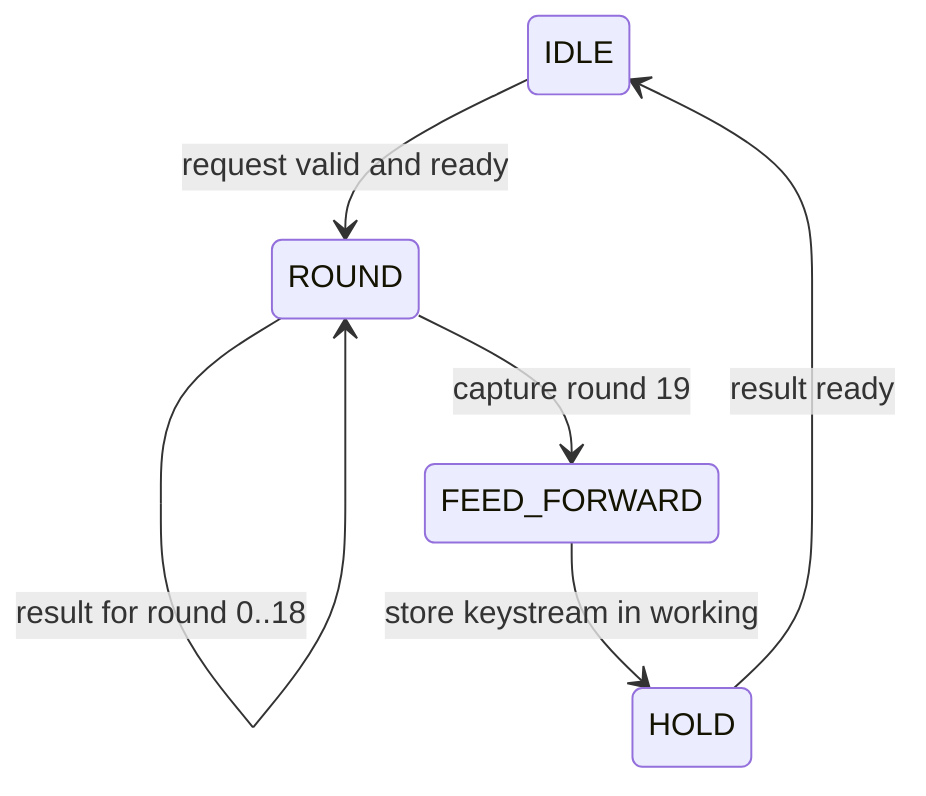

# ChaCha20

Read `cc20_qr` → `cc20_round` → `cc20_core` in `rtl/`.

| Block | Job |
|---|---|
| QR | Add/XOR/rotate, split into two registered stages |
| Round | Four QRs; column/diagonal word maps; two-stage valid/mode |
| Core | Capture request, run 20 rounds, feed-forward and hold result |

## State words

| Words | Contents |
|---|---|
| 0..3 | `expand 32-byte k` constants |
| 4..11 | Key |
| 12 | Block counter |
| 13..15 | Nonce |

A QR has four steps:

```text
a += b; d = ROTL(d XOR a, 16)
c += d; b = ROTL(b XOR c, 12)
a += b; d = ROTL(d XOR a, 8)
c += d; b = ROTL(b XOR c, 7)
```

The register boundary follows step 2. Rotations are bit wiring. QR registers run while reset is deasserted; the round supplies validity.

## Core flow



The request edge starts round 0. Even rounds use columns; odd rounds use diagonals. Each result feeds the next round directly. QR and round only compute rounds; their ports contain no result-load or hold controls.

The core captures round 19 in `r_working_state`. In FEED_FORWARD, 16 independent 32-bit additions update that same bank with the initial state. The bank then holds the keystream through HOLD and IDLE until the next block's final round is captured. This also retains the OTK for AEAD after the result transfer.

`w_feed_forward_sum` is the combinational adder output, sampled only in FEED_FORWARD. It recomputes after `r_working_state` updates. In HOLD, compare the reference against `o_keystream`, which directly exposes `r_working_state`.

Result-valid rises 41 cycles after request acceptance and stays high until consumed. The core owns the feed-forward and output storage.

The session owner holds key and nonce stable for the whole session. `cc20_core` reads them directly for request initialization and feed-forward; it does not store another key/nonce copy. There is one input contract and no sharing parameter. Counter is captured in the 32-bit `r_counter` on each accepted block request, so it may change immediately afterward.

AEAD top captures the session key/nonce at START and keeps them until the final tag transfer. A standalone caller must provide the same stability, at least through the block result transfer. The computed keystream then stays in `r_working_state`; changing idle inputs cannot change that held result. Invalid round input data defaults to zero.

Round accepts independent inputs every clock. Core has one context, so dependent rounds start every two clocks. Counter is supplied per request; AEAD chooses zero for OTK and one onward for payload.
