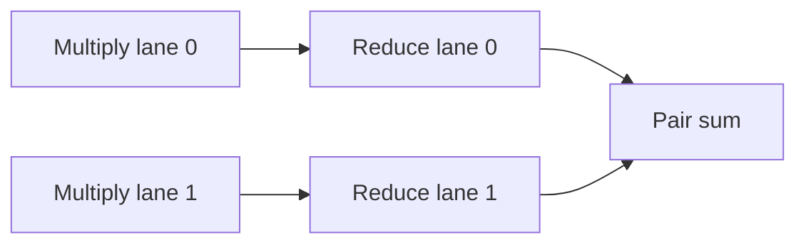
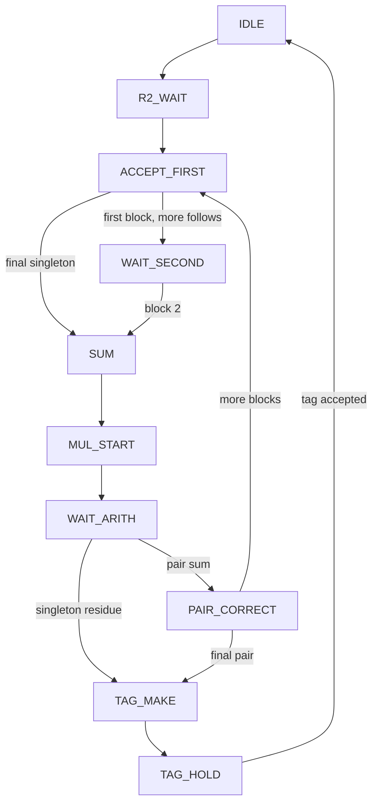

# Poly1305

The modulus is `p = 2^130 - 5`. Clamp the low OTK half to get `r`; the high half is `s`.

```text
n = LE(block128) + 2^128
h_next = (h + n)*r mod p
tag = low128(h + s)
```

The core accepts complete 16-byte blocks through `i_block[127:0]`, with
`i_block_valid`/`o_block_ready` and `i_last` marking the final actual block.
There is no byte-count port or empty terminal beat. AEAD owns zero-padding
of partial AAD/ciphertext and always supplies a final 16-byte lengths block,
including for empty messages. The encoded operand is fixed wiring:
`{2'b01, i_block}`. Byte count on the external AEAD word interface still
identifies valid bytes in its final 32-bit word.

## A multiplier and reducer per lane

Two blocks are grouped as:

```text
x = (h + n[0]) mod p
lane 0: x*r² mod p
lane 1: n[1]*r mod p
h_next = (lane0 + lane1) mod p
```

`r²` is computed once per OTK. A new AEAD nonce creates a new OTK, so setup repeats for every message.

| File in rtl/ | Job |
|---|---|
| `p1305_mul_r4.v` | [67-cycle unsigned multiply](multiplier.md) |
| `p1305_reduce.v` | [Two-stage canonical reduction](reducer.md) |
| `p1305_pair.v` | Start one/two lanes and hold their result handshake |
| `p1305_core.v` | Key/block order, accumulator and tag |

The lane arrays use indices 0 and 1. Each generate-loop instance owns one multiplier and one reducer. Pair mode starts both multipliers together, then both reducers together. Each reducer holds its own canonical residue until the atomic pair transfer; there is no product mux or separate first-residue register.



Single mode starts only lane 0; lane 1's output is ignored. Result-valid rises after 69 cycles in either mode. Pair outputs stay stable until both are consumed on the same valid/ready edge.

## Register lifetime

| Register | Contents |
|---|---|
| `r_n0` / `r_n1` | Encoded first / second block |
| `r_sum` | First `h+n0`, then the two-residue sum |
| `r_h` | Accumulator; final tag during TAG_HOLD |
| `r_pair_mode` / `r_pair_last` | Whether both lanes run / whether this pair ends the message |

The core stores block 1 while waiting for block 2. If block 1 has `i_last=1`,
it selects a final singleton immediately. Otherwise block 2 completes a pair;
its `i_last` determines whether more pairs follow. SUM captures `h+n0` before
launching arithmetic. Keeping this register boundary separates input encoding
from the wide addition.

Pair and singleton use the same SUM, MUL_START and WAIT_ARITH states. On pair-result transfer, the core captures the sum of the two residues, then corrects it on the next clock. A singleton residue goes directly to `r_h`. Each reducer retains its own result until transfer.

## Shared sum correction

Both sums are below `2p`: `h < p` and `n0 < p`; each lane residue is also below `p`. Thus only one subtraction is needed.

```text
t = {0, low130(sum)} + 5
reduced = (sum[130] OR t[130]) ? low130(t) : low130(sum)
```

For `sum >= p`, the selected low bits equal `sum-p`. This uses one constant-five addition and carry selection, shared between operand preparation and pair completion.

## Control flow

The controller has ten states. Initialization computes `r²`; both block modes share the preparation/launch/wait path.



## Timing

| Operation | Cycles |
|---|---:|
| OTK `r²` setup | 70 |
| Pair, from accepting block 2 to accumulator update | 73 |
| Final singleton to accumulator update | 72 |
| Tag addition after accumulator update | 1 |

These counts exclude input waits and tag backpressure. Tag stays stable while valid is high and ready is low. START loads a key while idle; reset aborts control without wiping datapath values.
